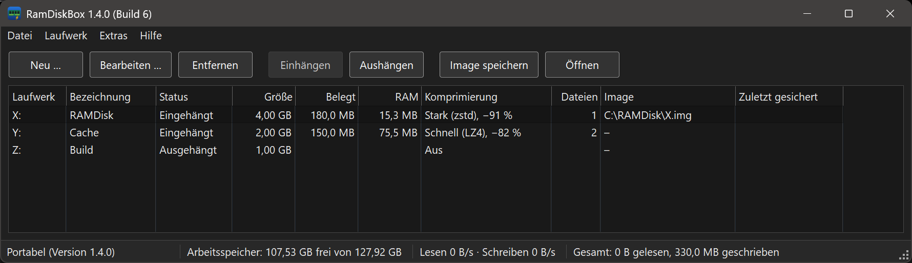
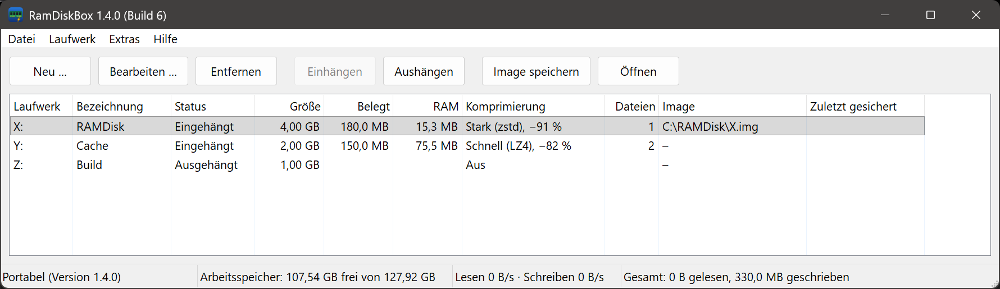
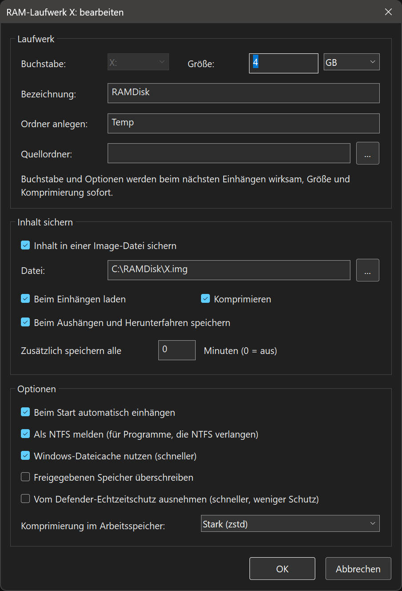
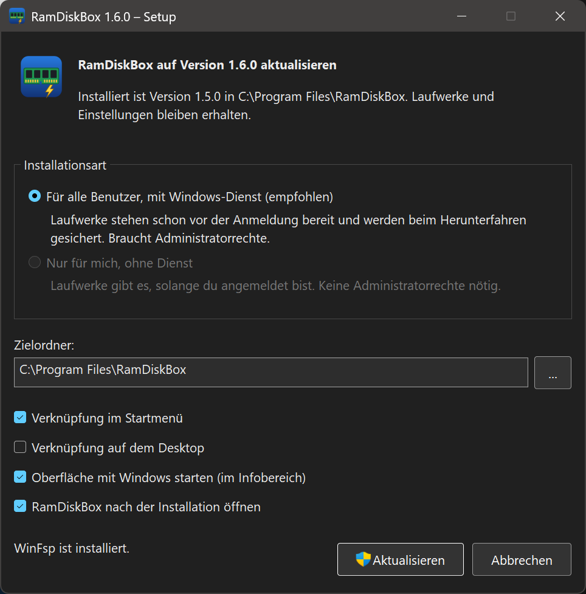

# RamDiskBox

RAM-Laufwerke für Windows 10/11: Ein Teil des Arbeitsspeichers wird zu einem sehr schnellen Laufwerk, etwa für
TEMP-Ordner, Browser-Caches, Build-Ordner oder Zwischendateien. Der Inhalt kann auf Wunsch in einer Image-Datei
gesichert und beim nächsten Start wiederhergestellt werden.

**Download:** Setup und portable Fassung unter [Releases](https://github.com/MatzeRunner8/RamDiskBox/releases).
Voraussetzung ist [WinFsp](https://winfsp.dev). English: [README.md](README.md)

<p align="center">
  
</p>

## Funktionen

- **Mehrere RAM-Laufwerke** mit frei wählbarem Buchstaben, Größe und Bezeichnung
- **Dynamischer Speicher:** Arbeitsspeicher wird erst belegt, wenn Daten auf dem Laufwerk liegen, und beim Löschen sofort freigegeben
- **Größe im laufenden Betrieb ändern**
- **Komprimierung im Arbeitsspeicher:** Schnell (LZ4), Normal (LZ4 HC) oder Stark (zstd), auch im laufenden Betrieb umschaltbar.
  - Dateien werden kurz nach dem Schließen im Hintergrund komprimiert. Bei Textdaten spart das 86 % (LZ4) bis 95 % (zstd) RAM.
  - Ein Stufenwechsel rechnet vorhandene Blöcke im Hintergrund um, „Aus“ entpackt sie wieder.
  - Nicht komprimierbare Blöcke (z. B. ZIP, Videos) bleiben unverändert.
  - Die eingestellte Laufwerksgröße gilt weiter für die Dateien; die Komprimierung spart Arbeitsspeicher.
- **Image-Sicherung:** beim Einhängen laden, beim Aushängen und Herunterfahren speichern, zusätzlich alle *n* Minuten; komprimiert (XPRESS) mit Prüfsummen, atomar ersetzt. Ein defektes Image wird beiseitegelegt statt überschrieben.
- **Ordner automatisch anlegen** (z. B. `Temp`)
- **Quellordner:** Ein Ordner auf der Festplatte wird beim Einhängen ins RAM-Laufwerk kopiert, wenn kein Image geladen wird.
  - Zeitstempel und Attribute bleiben erhalten, Nullbereiche belegen keinen Speicher.
  - Verknüpfungen (Junctions, Symlinks) werden nicht verfolgt.
  - Ist das Laufwerk zu klein, wird ein Teil kopiert und eine Warnung angezeigt.
- **Ausnahme vom Defender-Echtzeitschutz** (Standard: aus):
  - beschleunigt das Anlegen vieler kleiner Dateien, verringert aber den Schutz für dieses Laufwerk
  - braucht den Dienstmodus
  - gilt nur, solange das Laufwerk eingehängt ist, und wird beim Aushängen (bzw. nach einem Absturz beim nächsten Start) wieder entfernt
- **TEMP/TMP umleiten** auf ein RAM-Laufwerk, mit Rücksetzen auf den vorherigen Wert
- **Cache verlagern:** Browser-Caches (Chrome, Edge, Firefox, Brave, Opera, Vivaldi u. a.) und Programme wie VS Code, Discord oder Steam per Verzeichnisverbindung aufs RAM-Laufwerk legen; jedes Programm und Profil bekommt einen eigenen Ordner, der bei jedem Einhängen neu angelegt wird
- **Zwei Betriebsarten:**
  - **Portabel:** ohne Installation; die Laufwerke gibt es, solange du angemeldet bist
  - **Windows-Dienst:** Laufwerke stehen schon vor der Anmeldung bereit und gelten für alle Benutzer
- **NTFS-kompatibel:** Zugriffsrechte (ACLs), alternative Datenströme, Verzeichnisverbindungen und symbolische Links, Groß-/Kleinschreibung erhalten. Auf Wunsch meldet sich das Laufwerk als „NTFS“ für Programme, die das verlangen.
- **Statistik:** Belegung, RAM-Verbrauch, aktuelle Lese-/Schreibrate, Gesamtzähler und Spitzenwerte
- **Oberfläche** (Infobereich, Autostart) und **Kommandozeile** `rdbctl`
- **Deutsch und Englisch:** Sprache automatisch nach der Windows-Anzeigesprache, in den Einstellungen umstellbar. Das gilt auch für Meldungen des Hintergrundprozesses und für `rdbctl` (`RDB_LANG=de|en` erzwingt eine Sprache).
- **Hell und Dunkel:** folgt der Windows-Einstellung (auch beim Umschalten im laufenden Betrieb) oder fest „Hell“/„Dunkel“; bei Kontrastdesigns bleiben die Systemfarben
- **Datenschutz:** keine Telemetrie, keine Update-Prüfung, keine Netzwerkzugriffe

## Bildschirmfotos

<p align="center">
  
</p>
<p align="center">
  
  &nbsp;
  
</p>

## Voraussetzung

[WinFsp](https://winfsp.dev) 2.x (kostenlos, Open Source) als Dateisystem-Treiber. RamDiskBox prüft beim Start,
ob WinFsp installiert ist, und bietet sonst die Download-Seite an.

## Installation

**Setup** (`RamDiskBox-<Version>-Setup.exe`) mit zwei Installationsarten:

- **Für alle Benutzer, mit Windows-Dienst** (empfohlen, Administratorrechte):
  - Die Laufwerke stehen schon vor der Anmeldung bereit und werden beim Herunterfahren gesichert.
  - Programme liegen in `C:\Programme\RamDiskBox`; Laufwerks-Einstellungen, Protokoll und Images in `C:\ProgramData\RamDiskBox`, die Einstellungen der Oberfläche je Benutzer in `%APPDATA%\RamDiskBox`.
  - Programm- und Datenordner können nur Administratoren ändern, weil der Dienst als SYSTEM läuft.
- **Nur für mich, ohne Dienst** (keine Administratorrechte):
  - Programme und Daten liegen in `%LOCALAPPDATA%\Programs\RamDiskBox`.
  - Die Laufwerke gibt es, solange du angemeldet bist; dafür startet die Oberfläche mit Windows.

Weitere Hinweise:
- Ein erneuter Start des Setups aktualisiert die Installation; Laufwerke und Einstellungen bleiben erhalten.
- Entfernen geht über **Einstellungen → Apps** oder `Uninstall.exe` im Programmordner. Einstellungen und Images bleiben erhalten, wenn du das beim Entfernen nicht anders wählst.
- Still installieren: `RamDiskBox-Setup.exe /quiet [/user] [/dir=Pfad] [/desktop] [/autostart=0|1]`. Still entfernen: `Uninstall.exe /uninstall /quiet [/purge]`.
- WinFsp installiert das Setup nicht mit; fehlt es, öffnet es die Download-Seite.

**Portabel** (`RamDiskBox-<Version>-portable.zip`): entpacken und starten, alles bleibt im Ordner. Den Dienst kannst
du dann unter **Extras → Einstellungen** einrichten. Das Setup ist dafür sicherer, weil ein Dienst aus einem Ordner,
in den du ohne Adminrechte schreiben kannst, von anderen Programmen ausgetauscht werden könnte.

**Sicherheit im Dienstmodus:** Der Dienst liest und schreibt Images als SYSTEM. Deshalb gilt ohne Administratorrechte:
- Images liegen nur direkt im Image-Ordner des Dienstes.
- Quellordner und Defender-Ausnahme setzen nur Administratoren. Dazu die Oberfläche oder `rdbctl` als Administrator starten.

## Schnellstart

1. RamDiskBox installieren (oder portabel entpacken) und starten
2. **Neu …** wählen, Buchstabe, Größe und Bezeichnung einstellen, OK
3. Optional unter **Extras → TEMP/TMP umleiten …** den Temp-Ordner auf das Laufwerk legen
4. Optional unter **Extras → Cache verlagern …** Browser-Caches auf das Laufwerk legen (Browser vorher schließen)

Ohne Image ist der Inhalt eines RAM-Laufwerks beim Aushängen, Abmelden oder Herunterfahren weg. Was erhalten
bleiben soll, braucht „Inhalt in einer Image-Datei sichern“.

## Dateien

Portabel und bei „nur für mich“ liegt alles neben der EXE (bei „für alle Benutzer“ siehe Installation):

| Datei | Inhalt |
|---|---|
| `RamDiskBox.exe` | Oberfläche |
| `RamDiskBoxSvc.exe` | Hintergrundprozess bzw. Windows-Dienst, der die Laufwerke bereitstellt |
| `rdbctl.exe` | Kommandozeile |
| `RamDiskBox.ini` | Laufwerke, Dienst-Einstellungen und Statistik |
| `RamDiskBoxGui.ini` | Einstellungen der Oberfläche |
| `RamDiskBox.log` | Protokoll (wird ab 1 MB rotiert) |
| `Images\` | vorgeschlagener Ort für Image-Dateien |

Ist der Dienst eingerichtet, startet Windows `RamDiskBoxSvc.exe` aus diesem Ordner. Verschiebe den Ordner dann
nicht mehr, oder entferne vorher den Dienst.

Bis Version 1.2 hieß das Programm „RAMDiskBox“. Die alten Dateien `RAMDiskBox.ini` und `RAMDiskBoxGui.ini` können
unverändert in den neuen Ordner kopiert werden; Windows unterscheidet bei Dateinamen nicht nach Groß-/Kleinschreibung.

## Kommandozeile

```
rdbctl list
rdbctl create R 4G label=RAMDisk folders=Temp image=C:\RAMDisk\R.img
rdbctl update R 8G autosave=30 compress=max source=D:\Vorlage
rdbctl dismount R [force] [discard]
rdbctl mount R
rdbctl save R [neuer\Pfad.img]
rdbctl resize R 6G
rdbctl delete R
rdbctl iostats
rdbctl lifetime [reset]
rdbctl settings allowuser on|off
rdbctl status
rdbctl quit
```

Optionen für `create`/`update`: `label=`, `folders=`, `image=`, `autosave=Minuten`, `compress=off|fast|normal|max`, `source=Ordner`, `avexclude`, `noload`, `nosave`,
`nocompress`, `noauto`, `nontfs`, `nocache`, `wipe`, `nomount` (für `update` auch die positiven Formen
`load save compress auto ntfs cache nowipe noavexclude`). Dienst einrichten/entfernen: `RamDiskBoxSvc.exe install` bzw.
`uninstall` mit Administratorrechten.

## Leistung und Grenzen

Gemessen auf einem PC mit 128 GB RAM (256-MB-Datei, .NET `File.WriteAllBytes`/`ReadAllBytes`):
etwa **1,2 GB/s schreiben** und **2,5–3 GB/s lesen**. RamDiskBox läuft als Dateisystem im Benutzermodus über
WinFsp und ist damit so schnell wie WinFsps eigenes Referenz-Dateisystem `memfs`.

- **Viele kleine Dateien:** Hier bremst vor allem der Echtzeitscan von Windows Defender. Mit der Option „Vom Defender-Echtzeitschutz ausnehmen“ waren Anlegen, Öffnen und Lesen im Test 19- bis 41-mal schneller (zum Beispiel 4.400 statt 230 neue 64-KB-Dateien pro Sekunde). Im Dienstmodus behält RamDiskBox außerdem den Windows-Cache, das beschleunigt erneutes Lesen auch ohne Ausnahme.
- **Benchmarks ohne Windows-Cache** (CrystalDiskMark, DiskSpd): RamDiskBox erreicht rund 2,6 GB/s lesend, 5 GB/s schreibend und 150–300 MB/s bei 4K-Zugriffen. Das ist die Grenze von WinFsp, denn jeder Zugriff geht vom Kernel in den Dienst und zurück; WinFsps eigenes `memfs` misst genauso. RAM-Disks mit eigenem Kerneltreiber sind hier um ein Vielfaches schneller.
- Der Inhalt liegt im Speicher des RamDiskBox-Prozesses. Bei akutem Speichermangel kann Windows Teile davon in die Auslagerungsdatei verschieben.
- Mit Komprimierung liest das erste Öffnen einer komprimierten Datei mit etwa 1,4–1,5 GB/s (256 MB Text, alle Stufen). zstd komprimiert im Hintergrund rund 85 MB/s.
- Keine festen Links (WinFsp unterstützt sie nicht).
- Ohne Dienst (portabel bzw. „nur für mich“) gelten die Laufwerksbuchstaben nur für deine Anmeldung. Programme, die als Administrator laufen, sehen die Laufwerke dann nicht; Windows behandelt verbundene Netzlaufwerke genauso. Im Dienstmodus gelten sie für alle.
- Lässt sich das Image beim Einhängen nicht lesen (gesperrt, keine Rechte, Speicherort nicht erreichbar), bleibt das Laufwerk ausgehängt, damit das Image nicht durch ein leeres Laufwerk ersetzt wird. Änderungen stehen in `CHANGELOG.md`.
- Die Laufwerke erscheinen im Explorer, aber nicht in der Datenträgerverwaltung.

## Bauen

Visual Studio 2026 (v18) mit C++-Workload und WinFsp mit Entwicklerdateien (`msiexec /i winfsp-x.y.msi
INSTALLLEVEL=1000`), dann `build.bat`. Ergebnis in `build\bin`. `tools\pack.ps1` stellt das portable Paket in
`dist\` zusammen.

## Lizenz

Eigener Code: MIT (siehe `LICENSE`). Enthalten sind LZ4 1.10.0 © Yann Collet (BSD 2-Clause, `LICENSE-lz4.txt`) und
zstd 1.5.7 © Meta Platforms (BSD 3-Clause, `LICENSE-zstd.txt`).
WinFsp © Bill Zissimopoulos steht unter GPLv3 mit FLOSS-Ausnahme und wird separat installiert. RamDiskBox enthält
keinen WinFsp-Code, sondern bindet zur Laufzeit dessen DLL ein.
