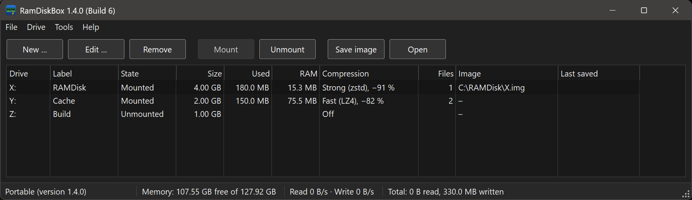
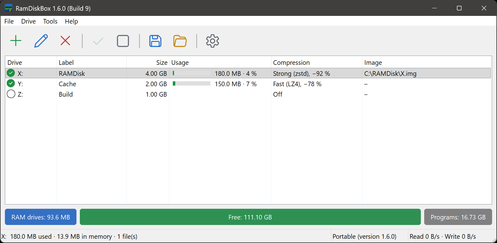
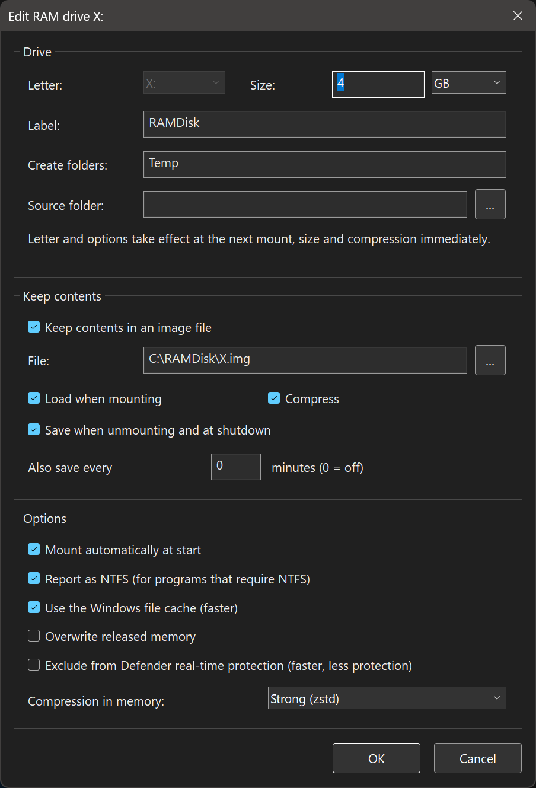
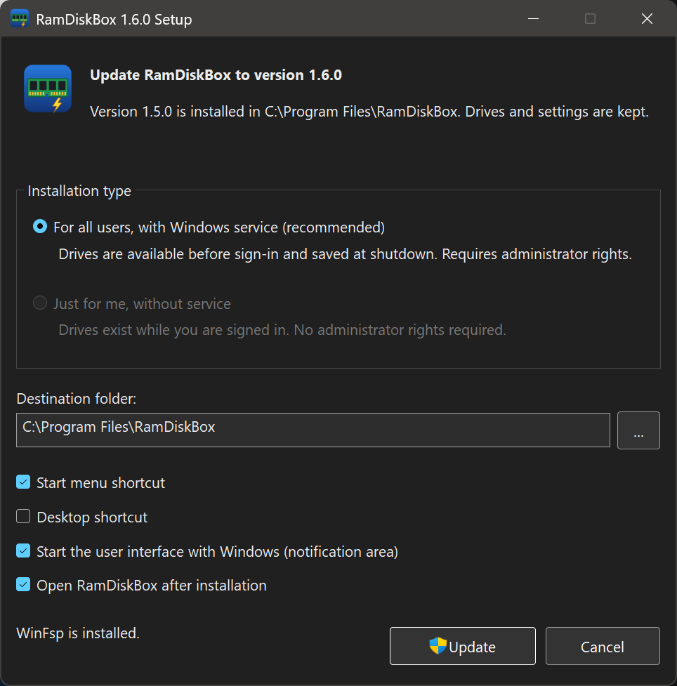

# RamDiskBox

RAM drives for Windows 10/11: part of your memory becomes a very fast drive for TEMP folders, browser caches,
build output or scratch files. Optionally the contents are kept in an image file and restored at the next start.

**Download:** setup and portable version under [Releases](https://github.com/MatzeRunner8/RamDiskBox/releases).
Requires [WinFsp](https://winfsp.dev). Deutsch: [README.de.md](README.de.md)

<p align="center">
  
</p>

## Features

- Several RAM drives with free choice of letter, size and label
- Dynamic memory: RAM is only used once data is stored, and released immediately on delete
- Resize while mounted
- In-memory compression: fast (LZ4), normal (LZ4 HC) or strong (zstd), switchable while mounted; files are compressed in the background shortly after they are closed (text: 86 % to 95 % less RAM), incompressible blocks stay as they are, changing the level converts existing blocks
- Source folder copied into the drive at mount when no image is loaded (timestamps and attributes kept, zero ranges sparse, links not followed)
- Optional exclusion from Defender real-time protection (off by default, service mode, only while mounted; less protection)
- Image backup: load on mount, save on unmount and at shutdown, plus every *n* minutes; XPRESS-compressed with checksums, replaced atomically; a damaged image is set aside instead of overwritten
- Folders created automatically (e.g. `Temp`)
- Redirect TEMP/TMP to a RAM drive and restore it later
- Portable mode (no installation) or Windows service (drives available before sign-in, for all users)
- NTFS-compatible: ACLs, alternate data streams, junctions and symbolic links, case preserving; optionally reports "NTFS" to programs that require it
- Statistics: usage, RAM, current throughput, lifetime counters and peaks
- GUI (notification area, autostart) and command line `rdbctl`
- German and English, chosen automatically from the Windows display language and switchable in the settings; this also covers background-process messages and `rdbctl` (`RDB_LANG=de|en` forces a language)
- Light and dark mode: follows the Windows setting (also when it changes while running) or fixed light/dark; high-contrast themes keep the system colors
- No telemetry, no update checks, no network access

## Screenshots

<p align="center">
  
</p>
<p align="center">
  
  &nbsp;
  
</p>

## Requirements

[WinFsp](https://winfsp.dev) 2.x (free, open source) as file system driver.

## Installation

- **Setup** (`RamDiskBox-<version>-Setup.exe`), two installation types:
  - **For all users, with Windows service** (recommended, administrator rights): drives are available before sign-in and saved at shutdown. Programs go to `C:\Program Files\RamDiskBox`; drive settings, log and images to `C:\ProgramData\RamDiskBox` (both writable only by administrators, since the service runs as SYSTEM); user-interface settings per user in `%APPDATA%\RamDiskBox`.
  - **Just for me, without service** (no administrator rights): `%LOCALAPPDATA%\Programs\RamDiskBox`, data next to the programs; drives exist while you are signed in.
  - Running the setup again updates the installation. Remove it via **Settings → Apps** or `Uninstall.exe`; settings and images are kept unless you choose otherwise. Quiet: `RamDiskBox-Setup.exe /quiet [/user] [/dir=path]`, `Uninstall.exe /uninstall /quiet [/purge]`. WinFsp is not bundled.
- **Portable** (`RamDiskBox-<version>-portable.zip`): unzip and run; everything stays in the folder.
- **Service mode security:** without administrator rights, image files can only be placed directly in the service's image folder, and only administrators can set a source folder or the Defender exclusion.

## Quick start

Install (or unzip) and run `RamDiskBox.exe`, choose **New …**, set letter, size and label. Without an image the contents are lost
on unmount, sign-out or shutdown; enable "Keep contents in an image file" for anything that must survive.
Settings, log and images live next to the EXE. Up to version 1.2 the program was called "RAMDiskBox"; its
`RAMDiskBox.ini` and `RAMDiskBoxGui.ini` can be copied into the new folder unchanged.

## Command line

```
rdbctl list | status | quit
rdbctl create R 4G label=RAMDisk folders=Temp image=C:\RAMDisk\R.img
rdbctl update|mount|dismount|save|resize|delete R ...
rdbctl iostats | lifetime [reset] | settings allowuser on|off
RamDiskBoxSvc.exe install | uninstall      (administrator)
```

## Performance and limits

About 1.2 GB/s write and 2.5–3 GB/s read for a 256 MB file, on par with WinFsp's reference `memfs`.

- Many small files: Windows Defender real-time scanning is the main brake. With "Exclude from Defender real-time protection", creating, opening and reading were 19 to 41 times faster in tests (e.g. 4,400 instead of 230 new 64 KB files per second). In service mode RamDiskBox also keeps the Windows cache, which speeds up re-reading even without the exclusion.
- Benchmarks without the Windows cache (CrystalDiskMark, DiskSpd): about 2.6 GB/s read, 5 GB/s write and 150–300 MB/s for 4K access. That is WinFsp's limit, since every access goes from the kernel to the service and back; WinFsp's own `memfs` measures the same. RAM disks with their own kernel driver are many times faster here.
- Data lives in the RamDiskBox process and may be paged out under severe memory pressure.
- With compression the first read of a compressed file runs at about 1.4–1.5 GB/s; zstd compresses at about 85 MB/s in the background.
- No hard links.
- Without the service (portable or "just for me") drive letters exist only in your sign-in session; programs running as administrator do not see them, just like mapped network drives. In service mode they are visible to everyone.
- If the image cannot be read at mount time (locked, no permission, location unreachable), the drive stays unmounted, so the image is never replaced by an empty drive. See `CHANGELOG.md` for changes.

## Build

Visual Studio 2026 (v18) with C++ and WinFsp developer files, then `build.bat`; `tools\pack.ps1` creates the
portable package.

## License

MIT for this code (see `LICENSE`). Includes LZ4 1.10.0 © Yann Collet (BSD 2-Clause, `LICENSE-lz4.txt`) and zstd 1.5.7 © Meta Platforms (BSD 3-Clause, `LICENSE-zstd.txt`). WinFsp © Bill Zissimopoulos is GPLv3 with FLOSS exception and installed separately.
